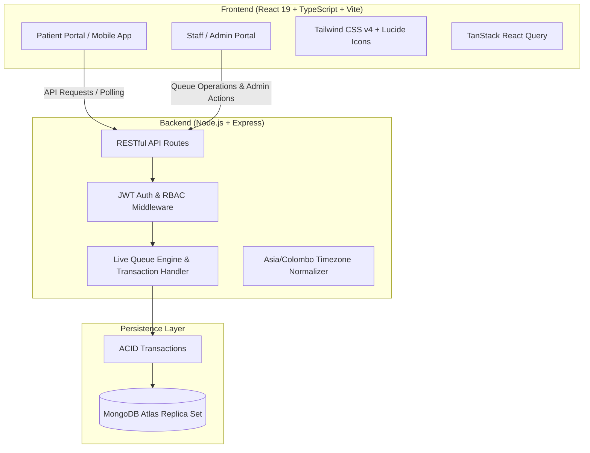

# 🏥 MediTrack — Smart OPD Appointment & Live Queue Management System

<p align="center">
  
  
  
  
  
  
  
</p>

---

## 📌 Overview

**MediTrack** is an enterprise-grade Outpatient Department (OPD) management system designed to streamline patient appointments, automate live queues, and empower hospital staff with real-time operational workflows. 

Featuring dedicated responsive web portals for **Patients** and **Hospital Staff / Admins**, as well as an Android build powered by Capacitor, MediTrack eliminates chaotic waiting rooms by providing dynamic waiting time estimations, transactional ticket calling, and automated queue tracking.

---

## ✨ Key Features

### 👤 Patient Portal (`/login`)
- **Self-Service Registration & Secure Auth:** Instant mobile/email account creation with protected JWT authentication.
- **Doctor & Specialist Booking:** Browse doctor schedules, available dates, and real-time slot availability.
- **Family & Dependent Profiles:** Book and manage appointments for family members under a single patient account.
- **Live Queue Tracking & Ticket Updates:** Real-time ticket status (`WAITING`, `ALMOST_TURN`, `CALLING`, `IN_CONSULTATION`, `COMPLETED`) with estimated wait calculations.
- **Smart Reminders & Notifications:** Contextual alerts for upcoming appointments and queue turn updates.

### 🩺 Staff & Admin Portal (`/staff/login`)
- **Interactive Live Queue Board:**
  - One-click **Call Next** for waiting patients.
  - Strict queue transition pipeline (`CALLING` ➔ `IN_CONSULTATION` ➔ `COMPLETED`).
  - Ability to **Hold**, **Skip**, or handle no-shows cleanly.
- **Reception & Walk-In Desk:** Quickly register walk-in patients and issue instant OPD queue tickets.
- **Doctor Roster & OPD Schedules:** Define consultation slots, shift timetables, and room allocations.
- **Team Management & Role-Based Access (Admin):** Granular access control for Admins, Doctors, and Reception Staff.
- **Real-Time OPD Analytics:** View daily patient throughput, peak hours, and consultation statistics.
- **Configurable Auto-Polling:** Customizable data refresh rates (15s, 30s, 60s) to keep screens synchronized without manual reload.

---

## 🏗️ System Architecture



---

## 💻 Tech Stack

| Area | Technologies |
| :--- | :--- |
| **Frontend** | React 19, TypeScript 5.8, Vite 6, Tailwind CSS v4, TanStack Query, React Hook Form, Zod, Lucide Icons, Recharts, Sonner |
| **Mobile** | Capacitor 8 (Cross-platform Android runtime & pre-built APK) |
| **Backend** | Node.js 22+, Express 4.21, TypeScript, Tsx, Mongoose 8, Helmet, CORS, Morgan |
| **Database** | MongoDB Atlas (Replica Set required for Multi-Document ACID Transactions) |
| **Testing & Quality** | Node.js Test Runner, Oxlint, TypeScript strict typecheck |

---

## 🚀 Quick Start Guide

### 1️⃣ Prerequisites
- **Node.js**: `v22.x` or later
- **npm**: `v10.x` or later
- **MongoDB Atlas**: Free/Paid Replica-Set cluster (Transactions are mandatory). Ensure your IP is whitelisted under Atlas *Network Access*.

### 2️⃣ Clone & Install Dependencies

```bash
# Clone repository
git clone https://github.com/Bulee048/MediTrack.git
cd MediTrack

# Install Client & Server packages
npm --prefix client ci
npm --prefix server ci
```

### 3️⃣ Configure Environment Variables

Create `.env` inside the `server/` directory:

```env
# MongoDB Atlas Connection String (Must be a replica set)
MONGODB_URI=mongodb+srv://<username>:<password>@<cluster>.mongodb.net/meditrack?retryWrites=true&w=majority

# JWT Signing
JWT_SECRET=your_super_strong_secret_key_here
JWT_EXPIRES_IN=7d

# Server & Client Configuration (Optional Defaults)
PORT=5004
CLIENT_URL=http://localhost:5184
NODE_ENV=development
```

*(Optional)* Create `client/.env.local` if you change backend ports:
```env
VITE_API_BASE_URL=http://localhost:5004/api
```

---

## ⚡ Running the Application

### Option A: One-Command Launcher (Recommended)
From the project root:

```bash
npm run dev
```

This concurrently boots up both backend and frontend servers with synchronized CORS and DNS failovers:
- 🌐 **Patient Web Portal**: [http://localhost:5184/login](http://localhost:5184/login)
- 🏥 **Staff & Admin Dashboard**: [http://localhost:5184/staff/login](http://localhost:5184/staff/login)
- 🩺 **Backend Health API**: [http://localhost:5004/api/health](http://localhost:5004/api/health)

### Option B: Isolated Demo Mode with Seed Data
To run against isolated demo fixtures (`meditrack_demo` database) without touching production records:

```bash
# Seed demo accounts & sample doctor rosters
npm run seed:demo

# Start application in demo mode
npm run dev:demo
```
> Demo credentials will be generated and saved to `server/.demo/credentials.json`.

---

## 📱 Mobile App (Android)

MediTrack is packaged with **Capacitor** for native Android performance.
- Pre-built debug APK is available directly in the project root: [`MediTrack-debug.apk`](./MediTrack-debug.apk)
- To build or run via Android Studio:
  ```bash
  cd client
  npx cap sync android
  npx cap open android
  ```

---

## 🧪 Testing & Verification

MediTrack maintains high code quality and test coverage across both client components and server transactions:

```bash
# Frontend Code Quality & Unit Tests
npm --prefix client run typecheck
npm --prefix client run lint
npm --prefix client run test:appointments
npm --prefix client run test:staff
npm --prefix client run test:queue
npm --prefix client run test:queue-controls

# Backend Code Quality & Integration Tests
npm --prefix server run typecheck
npm --prefix server run test:appointments
npm --prefix server run test:patient-app
npm --prefix server run test:reminders
npm --prefix server run test:queue-audit
```

---

## 📁 Repository Structure

```
MediTrack/
├── 📱 client/                  # Frontend Web & Mobile application (React 19 + Vite)
│   ├── android/                # Native Android Capacitor wrapper project
│   ├── src/                    # UI Components, pages, hooks, state & router
│   └── tests/                  # Frontend unit & component test suites
├── 🖥️ server/                  # Backend RESTful API (Express + Mongoose + TypeScript)
│   ├── src/                    # API routes, business logic, queue engine & models
│   ├── scripts/                # Database seeding & administrative scripts
│   └── tests/                  # Integration tests with MongoDB transaction fixtures
├── 📖 docs/                    # Technical architecture, functional audits & specifications
├── 📦 scripts/                 # Root developer dev-launchers & environment managers
├── 🤖 MediTrack-debug.apk      # Pre-compiled Android Debug APK
└── 📄 README.md                # Project documentation
```

---

## 🔒 Security & Best Practices

- **Strict ACID Transactions:** All queue ticket increments, calling events, and completion states run within atomic MongoDB transactions to eliminate race conditions.
- **Timezone Normalization:** Hospital schedules strictly follow standard `Asia/Colombo` timezone logic.
- **Zero Credential Leaks:** Password hashes, JWT secrets, and database credentials are fully sanitized from all client responses and git history.
- **Independent Session Profiles:** Patient and Staff sessions use segregated storage tokens on the same origin to avoid authentication conflicts.

---

## 🤝 Contributing

Contributions, issues, and feature requests are welcome!
1. Fork the Project
2. Create your Feature Branch (`git checkout -b feature/AmazingFeature`)
3. Commit your Changes (`git commit -m 'Add some AmazingFeature'`)
4. Push to the Branch (`git push origin feature/AmazingFeature`)
5. Open a Pull Request

---

## 📄 License

This project is licensed under the [MIT License](LICENSE).

</p>
